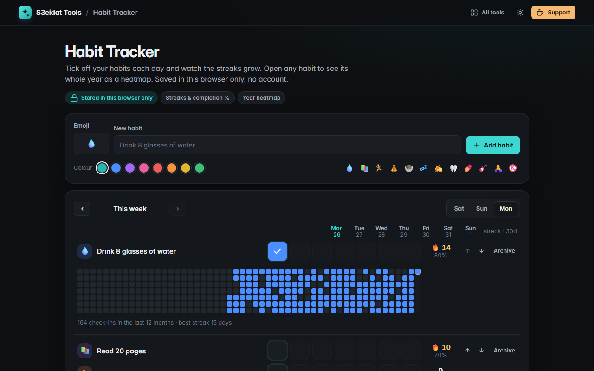

# Habit Tracker

> Build streaks, privately in your browser. Free, private, and it runs entirely in your browser.

### ▶ [Open Habit Tracker](https://s3eidat.github.io/habit-tracker/)



## Features

- Add habits with an **emoji** and a **colour**
- **Daily check grid for the week**; browse earlier weeks; choose whether your week starts on Saturday, Sunday or Monday
- **Current streak** (still alive until today ends), **best streak**, and **completion % over the last 30 days**
- A **year heatmap** for each habit (click its name)
- Weekly summary: done today, this week's completion, longest current streak
- **Reorder** habits, **archive** them (history kept), restore, or delete with undo
- **Export / import JSON** (imported files are validated)

## Privacy

Your habits never leave your device. They are stored in your browser's localStorage, with no server, no account
and no analytics. The page ships with a strict Content-Security-Policy (`connect-src 'self'`), so the browser
itself blocks any attempt to send data anywhere. Clearing your browser data deletes your history, so export a backup.

## Run it yourself

It's plain HTML, CSS and JavaScript with no build step:

```bash
git clone https://github.com/s3eidat/habit-tracker
cd habit-tracker
python -m http.server 8000
```

Then open http://localhost:8000.

## Support

If this saved you time, **[buy me a coffee ☕](https://s3eidat.github.io/coffee/)**. It keeps every tool free.

---

Part of **[S3eidat Tools](https://s3eidat.github.io/)**: 100+ free, private tools that run in your browser. MIT licensed.
